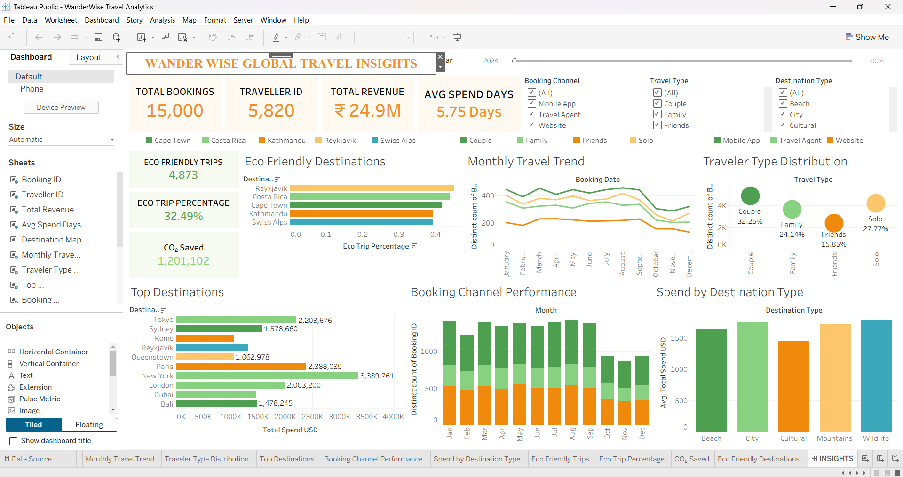

# 🌍 WanderWise — Global Travel Analytics Dashboard

## Project Overview
WanderWise is an interactive Tableau dashboard designed to analyze global travel trends, traveler preferences, destination performance, booking channels, revenue patterns, and sustainability.

The project uses a custom-generated synthetic dataset containing **15,000 travel booking records**.

## Tools & Technologies
- Tableau Public / Tableau Desktop
- CSV Dataset
- Data Visualization
- Calculated Fields
- Interactive Dashboards
- Business Intelligence

## Dashboard Features
- Total Bookings, Travelers, Revenue, and Average Stay KPIs
- Global Destination Map
- Monthly Travel Trends
- Traveler Type Distribution
- Top Destinations by Revenue
- Booking Channel Performance
- Average Spending Analysis
- Eco-Friendly Travel and CO₂ Savings Analysis
- Interactive Filters

## Dataset
- **Records:** 15,000
- **Columns:** 27
- **Period:** January 2024 – September 2026
- **Coverage:** 20 destinations

*Note: This dataset is synthetic and is intended for educational and portfolio purposes.*

## Business Objective
To understand traveler behavior, identify high-value destinations, analyze booking patterns, and explore sustainable tourism opportunities through interactive visual analytics.

## Dashboard Preview

## Key Skills Demonstrated
Tableau | Data Analytics | Business Intelligence | Data Visualization | Dashboard Design | Calculated Fields | Data Storytelling

## Author
Niraj Naniwal

**Data Analyst | Excel | SQL | Power BI | Tableau | Python**
